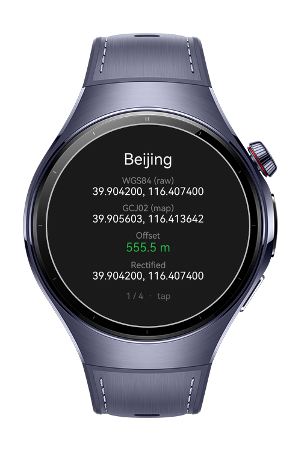
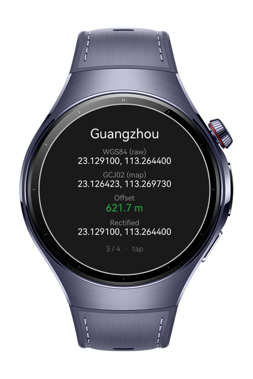
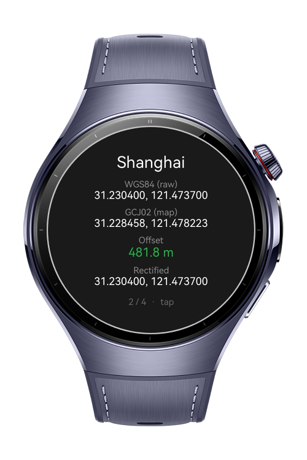

> **Note:** To access all shared projects, get information about environment setup, and view other guides, please visit [Explore-In-HMOS-Wearable Index](https://github.com/Explore-In-HMOS-Wearable/hmos-index).

# How to Build Coordinate Toolkit

A coordinate-system conversion utility for HarmonyOS Next smart wearables. The app demonstrates how to use `convertCoordinateSync` and `convertCoordinate` to convert raw GPS coordinates (WGS84) into the offset-encrypted system (GCJ02) required for accurate positioning on maps of mainland China, measures the offset between the two with `calculateDistance`, and shows one city at a time on a card. The codelab teaches how to perform coordinate conversion entirely offline, with no network or AppGallery Connect setup.

# Preview

<div>
  
  
  
  
</div>

# Use Cases

- **Coordinate System Conversion**: Demonstrates how to convert a WGS84 coordinate to GCJ02 using `convertCoordinateSync` for immediate display and `convertCoordinate` for the promise-based alternative.
- **Offset Measurement**: Shows how to measure the distance between the raw and converted coordinates with `calculateDistance`, making the abstract coordinate-system difference concrete in meters.
- **Conditional Rectification**: Illustrates calling `rectifyCoordinate` and shows its actual behavior — it only adjusts a coordinate when the device has an active routing location, otherwise returning the input unchanged.

**Target APIs**

| Module | Method | Role |
|---|---|---|
| map | `convertCoordinateSync` | Converts WGS84 to GCJ02 synchronously for per-card display |
| map | `convertCoordinate` | Converts WGS84 to GCJ02 asynchronously (promise-based) |
| map | `calculateDistance` | Measures the offset in meters between raw and converted coordinates |
| map | `rectifyCoordinate` | Rectifies a coordinate when an active routing location exists |
| mapCommon | `LatLng` / `CoordinateType` | Represents coordinates and selects the conversion direction |

# Technology

## Stack
- **Languages**: ArkTS, ArkUI
- **Frameworks**: HarmonyOS SDK 5.1.0(21)
- **Tools**: DevEco Studio Version 6.0.1.251
- **Libraries & Kits**:
  - `@kit.MapKit` — map (coordinate conversion, distance, rectification), mapCommon (LatLng, CoordinateType)
  - `@kit.LocalizationKit` — resourceManager for reading the city list, labels, and colors from resources

## Required Permissions
- None

# Directory Structure
```
entry/src/main/
├── ets/
│   ├── pages/
│   │   └── Index.ets               // Main UI page: reads cities, converts, renders the card, handles taps
│   └── conversion/
│       └── CoordinateConverter.ets // Conversion logic: convert (sync/async), distance, rectify
└── resources/
    └── base/element/
        ├── string.json             // City list (JSON), labels, and hint text
        └── color.json              // Screen and text colors
```
# Constraints and Restrictions

## Supported Device
- Huawei Watch 5
## Requirements
- A physical wearable device (the wearable emulator image may not include `SystemCapability.Map.Core`)
- HarmonyOS API level 12 or higher
# License
How to Build Coordinate Toolkit for HarmonyOS is distributed under the terms of the [LICENSE](./LICENSE).